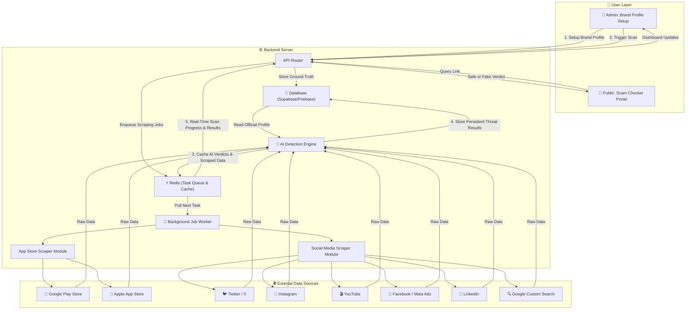

# 🛡️ Defence in Depth (DID) — Complete Hackathon Plan

> **Project Name:** Defence in Depth (DID)
> **Tagline:** *Multi-Layered AI-Powered Brand Impersonation Defence*

---

## 1. Project Overview

### One-Line Pitch
> **Defence in Depth** is an AI-powered platform that deploys multiple scanning layers across social media and app stores to detect, analyze, and help take down brand impersonators — before they reach your customers.

### The Problem
Brands are increasingly impersonated across social media platforms and mobile app stores. Threat actors create fake company profiles, scam accounts, fraudulent pages, and malicious mobile applications that imitate legitimate brands. These impersonations can:
- Deceive customers into sharing passwords or payment details
- Distribute scams and malware
- Steal user credentials
- Damage the brand's reputation
- Redirect users to fraudulent services

### The Solution
A **B2B (Business-to-Business) Web Application** where a company's security team can:
1. Define their official brand assets (logo, app names, social handles).
2. Automatically scan public App Stores and Social Media for impersonators.
3. Use AI to compare scraped results against the brand profile and flag fakes.
4. View threats on a clean, readable dashboard and take action.

### Who Uses This App?

| Role | What They Do in the App |
|---|---|
| **Marketing / Brand Manager** | Sets up the Brand Profile with all official names, logos, and handles |
| **Cybersecurity Analyst** | Monitors the dashboard daily for new threats detected by the AI |
| **Legal / Compliance Team** | Uses the generated reports to file takedown requests with app stores and platforms |

### Who Benefits From This App?
**Everyday consumers (the public).** By removing fake apps and scam accounts from the internet *at the source*, we protect millions of people before they ever encounter the threat. The company uses the dashboard; the public is protected by it.

---

## 2. Architecture Diagram

### How Data Flows (Step by Step)
1. **Brand Profile** → The company admin inputs their official brand data (name, logo, handles, apps). This is stored in the main database as the "ground truth."
2. **Scan Triggered** → When the admin clicks "Run Scan," the backend API creates background scraping tasks and pushes them into the **Redis Task Queue**.
3. **Async Background Workers** → Redis dispatches jobs to background workers (using Python Celery or RQ) so the web app stays fast and responsive without timing out.
4. **Data Scraped** → Workers run all scraper modules asynchronously across app stores and social platforms.
5. **AI Analysis & Caching** → Scraped items are sent to the Gemini AI engine. AI verdicts are saved in the main **Database** and cached in **Redis** to prevent duplicate API costs.
6. **Real-Time Progress** → Redis broadcasts live progress status (e.g., *"Scanning Google Play... 60% complete"*) back to the user's dashboard.

---

## 3. Recommended Tech Stack

| Layer | Technology | What It Does |
|---|---|---|
| **Frontend** | React + Next.js | Builds the dashboard and public portal that users see in the browser |
| **CSS Framework** | Tailwind CSS | Makes the dashboard look modern and professional with minimal effort |
| **Backend** | Python + FastAPI | Runs the API router, scraper scripts, and connects to the AI engine |
| **Task Queue & Cache** | **Redis** (Upstash Redis) | Manages background scraping jobs, caches AI results, and handles real-time scan progress |
| **AI Engine** | Google Gemini API | Compares scraped data against the Brand Profile using both text and image analysis |
| **Database** | Supabase or Firebase | Stores the Brand Profile, scan results, and threat history persistent data |
| **Frontend Hosting** | Vercel | Free hosting for the Next.js frontend with one-click deployment |
| **Backend Hosting** | Railway or Render | Free hosting for the Python backend server & Redis instance |

---

## 4. Feature 1: Brand Profile Setup (15% of Score)

> [!IMPORTANT]
> This is the foundation. Without this, the AI has nothing to compare against, and the entire app fails.

### What to Build
A settings page behind a login screen where the company admin enters all of their official brand information. This page is the first thing the user interacts with.

### Required Input Fields

| Field | Example Value | Why It's Needed |
|---|---|---|
| Company / Brand Name | `Nike` | Used as the search keyword across all scrapers |
| Official Developer Name | `Nike, Inc.` | Compared against the publisher name on scraped apps. If they don't match, it's a red flag |
| Official Website URL | `https://www.nike.com` | Compared against support URLs on scraped apps |
| Official Twitter Handle | `@Nike` | Whitelisted so it is never flagged as fake |
| Official Instagram Handle | `@nike` | Whitelisted so it is never flagged as fake |
| Official YouTube Channel | `youtube.com/@nike` | Whitelisted so it is never flagged as fake |
| Official Facebook Page | `facebook.com/nike` | Whitelisted so it is never flagged as fake |
| Official LinkedIn Page | `linkedin.com/company/nike` | Whitelisted so it is never flagged as fake |
| Official Google Play App Link | `play.google.com/store/apps/...` | Whitelisted so it is never flagged as fake |
| Official Apple App Store Link | `apps.apple.com/us/app/...` | Whitelisted so it is never flagged as fake |
| Official Logo | Upload a PNG/JPG file | Used by the AI for visual logo comparison against scraped app icons |

### What Judges Look For
- **Clear definition** of all legitimate assets (name, logo, handles, apps).
- **Input validation** — checking that URLs are valid, handles start with `@`, etc.
- The profile is **actively used** by the detection engine to guide all comparisons. It should not just be stored and ignored.
- Official assets are **automatically excluded** from the threat results (no false positives).

---

## 5. Feature 2: App Store Monitoring (30% of Score)

### 5.1 Google Play Store Scraping

#### Recommended Tool

| Detail | Value |
|---|---|
| **Tool Name** | google-play-scraper |
| **GitHub Repo** | [facundoolano/google-play-scraper](https://github.com/facundoolano/google-play-scraper) |
| **Modern Fork (Recommended)** | [@mradex77/google-play-scraper](https://github.com/mradex77/google-play-scraper) |
| **Language** | Node.js / TypeScript |
| **Cost** | Free and open-source |

#### How It Works
You give this tool the brand name (e.g., "Nike"). It automatically visits the Google Play Store search page, reads the HTML of the results, and returns structured data for every app it finds. For each app, it extracts the app title, developer/publisher name, app icon image, app store link, description, and developer ID.

#### Why the Modern Fork Is Better
The original library is largely unmaintained and breaks when Google changes its website layout. The modern fork by `@mradex77` includes daily automated tests against the live Google Play Store, so it catches layout changes immediately and stays up to date.

---

### 5.2 Apple App Store Scraping

#### Option A: iTunes Search API (Recommended — No scraping needed!)

| Detail | Value |
|---|---|
| **Type** | Official, free, public REST API provided by Apple |
| **How to Access** | Simply send a web request to Apple's public URL with the brand name |
| **Authentication** | None required — completely open |
| **Cost** | Free |

#### How It Works
This is the easiest data source in the entire project. Apple provides a free, public API that anyone can use. You simply send a request with the brand name, and Apple returns clean, structured data (in JSON format) for every matching app. Each result includes the app name, seller/developer name, app icon URL, app store link, description, and the seller's website URL. No scraping, no HTML parsing, no risk of being blocked.

#### Option B: Python Scraper Library

| Detail | Value |
|---|---|
| **Tool Name** | app-store-scraper |
| **Available on** | [PyPI](https://pypi.org/project/app-store-scraper/) (Python Package Index) |
| **GitHub Alternative** | [ChocoData/app-store-scraper](https://github.com/ChocoData-com/app-store-scraper) — actively maintained as of 2026 |
| **Language** | Python |
| **Cost** | Free |

#### Option C: Node.js Library

| Detail | Value |
|---|---|
| **Tool Name** | @perttu/app-store-scraper |
| **Available on** | [npm](https://www.npmjs.com/package/@perttu/app-store-scraper) |
| **Language** | TypeScript / Node.js |
| **Status** | Actively maintained — repaired many broken endpoints from the original, abandoned library |

---

### 5.3 What Data to Extract from Each App

| Data Field | What It Is | How It's Used for Detection |
|---|---|---|
| **App Title** | The name displayed on the store (e.g., "Nike: Shoes") | Compare to brand name — look for added keywords like "Free," "Official," "Crypto" |
| **Developer / Publisher Name** | The company that published the app (e.g., "Nike, Inc.") | **THE MOST IMPORTANT CHECK.** Must exactly match the Brand Profile. If it doesn't, it's a major red flag |
| **App Icon** | The logo image of the app | Sent to the AI for visual comparison against the official logo |
| **App Store URL** | The direct link to the app's store page | Compare to the official app link in the Brand Profile |
| **Description** | The full text description of the app | Check for copied text, suspicious links, or phishing language |
| **Developer Website / Support URL** | The website listed by the developer | If this domain doesn't match the official website in the Brand Profile, flag immediately |

---

## 6. Feature 3: Social Media Monitoring (30% of Score)

### 6.1 Twitter / X Monitoring

> [!TIP]
> While Twitter/X has restricted raw web scraping, there are **3 proven, working methods** to search and monitor profiles for a hackathon without getting blocked.

#### Method 1: Nitter Instance Scraping (`ntscraper`) — Recommended (No Login Needed!)

| Detail | Value |
|---|---|
| **Tool Name** | ntscraper |
| **GitHub Repo** | [alx-tri/scraptwitter](https://github.com/alx-tri/scraptwitter) (PyPI: `ntscraper`) |
| **Language** | Python |
| **Auth Required?** | **NO** — completely free and open-source |
| **Cost** | Free |

##### How It Works
Nitter is an open-source, privacy-focused alternative front-end for Twitter/X. The `ntscraper` Python library queries active public Nitter instances behind the scenes. You simply pass it your brand keyword (e.g. `"Nike"`), and it returns structured user profile data, handles, bios, follower counts, and avatar images without requiring any Twitter account logins, API keys, or browser cookies.

##### Why It's Great for Hackathons
- No risk of account bans (you aren't logged in).
- Bypasses Twitter's login wall.
- Returns clean JSON data ready for the Gemini AI engine.

---

#### Method 2: Twitter API v2 User Search Endpoint (Official Free / Basic Tier)

| Detail | Value |
|---|---|
| **Tool Name** | Twitter / X API v2 (`/2/users/search`) |
| **Provider** | Official X Developer Portal |
| **Auth Required?** | API Bearer Token (Free / Basic Developer Account) |
| **Cost** | Free Tier available |

##### How It Works
X offers an official endpoint specifically designed to search for user profiles matching a query string. By registering a free project in the X Developer Portal, you get a Bearer Token. Your backend makes a simple GET request to `https://api.twitter.com/2/users/search?query=Nike`, and Twitter returns official and look-alike profile data directly.

##### Key Advantage
- 100% legal, official, and zero risk of rate limits or blocks during a demo.

---

#### Method 3: `twscrape` with Account Rotation Pool

| Detail | Value |
|---|---|
| **Tool Name** | twscrape |
| **GitHub Repo** | [vladkens/twscrape](https://github.com/vladkens/twscrape) |
| **Language** | Python |
| **Auth Required?** | Yes (1-2 throwaway burner X accounts) |
| **Cost** | Free |

##### How It Works
`twscrape` maintains an internal SQLite database pool of burner X account credentials and session tokens. When you query for profiles, it automatically rotates through accounts and handles token refreshing, mimicking standard mobile app requests.

---

#### Summary of Twitter/X Monitoring Paths

| Path | Best For | Reliability | Setup Time |
|---|---|---|---|
| **`ntscraper` (Nitter)** | Fast, no-login scraping | ⭐⭐⭐⭐ (High) | 2 minutes (`pip install ntscraper`) |
| **Twitter API v2** | Guaranteed zero-block demo | ⭐⭐⭐⭐⭐ (Perfect) | 5 minutes (Get developer key) |
| **`twscrape`** | Advanced bulk scraping | ⭐⭐⭐ (Requires burner accounts) | 10 minutes |
| **Google Custom Search** | Universal emergency fallback | ⭐⭐⭐⭐⭐ (Bulletproof) | 2 minutes |

---

### 6.2 Instagram Monitoring

#### Recommended Tool

| Detail | Value |
|---|---|
| **Tool Name** | Instaloader |
| **GitHub Repo** | [instaloader/instaloader](https://github.com/instaloader/instaloader) |
| **Language** | Python |
| **Stars** | 8,000+ on GitHub |
| **Cost** | Free and open-source |
| **Auth Required?** | Optional — works for public profiles without logging in |

#### How It Works
Instaloader is widely considered the most maintained and reliable open-source Instagram tool. You give it a username, and it returns the profile's full name, bio/description, follower count, profile picture URL, external website link, and verification status (whether the account has a blue checkmark). It works best when scraping public data without logging in, which avoids the risk of account bans.

#### What to Check for Fake Instagram Profiles

| Red Flag | Example | Why It's Suspicious |
|---|---|---|
| Uses brand name but is NOT verified | `@nike_official_support` (no ✔️) | Real brands have verified badges |
| Bio contains suspicious links | `"Get free shoes → bit.ly/scam"` | Legitimate brands don't use URL shorteners for promotions |
| Very few followers for a "brand" account | 200 followers claiming to be Nike | Real brand accounts have millions |
| Recently created account | Account is only days or weeks old | Scammers create accounts quickly |
| Handle uses added words | `@nike_giveaway_2024` | Adding "giveaway," "free," or "official" is a classic scammer trick |

#### Alternative Tool

| Detail | Value |
|---|---|
| **Tool Name** | instagrapi |
| **GitHub Repo** | [adw0rd/instagrapi](https://github.com/adw0rd/instagrapi) |
| **Key Advantage** | More powerful — can search for users by keyword, not just by exact username |
| **Key Risk** | Requires login to an Instagram account. Carries a **higher risk of account bans** |

---

### 6.3 YouTube Monitoring

#### Recommended Tool

| Detail | Value |
|---|---|
| **Tool Name** | YouTube Data API v3 |
| **Type** | Official Google API |
| **Cost** | Free (10,000 units per day quota) |
| **Auth** | API Key (free from Google Cloud Console) |

#### Setup Steps
1. Go to the [Google Cloud Console](https://console.cloud.google.com/).
2. Create a new project.
3. Enable the "YouTube Data API v3" for that project.
4. Create an API Key in the "Credentials" section.
5. Use this API Key in your backend to search for channels by brand name.

#### How It Works
You send a search request with the brand name (e.g., "Nike") and specify that you want to search for "channels" only. The API returns a list of YouTube channels matching that name. For each channel, you get the channel name, channel ID, description, and thumbnail image. Your AI engine then compares these against the official YouTube channel in the Brand Profile.

#### What to Check for Fake YouTube Channels

| Red Flag | Example | Why It's Suspicious |
|---|---|---|
| Channel name uses brand but isn't the official channel | "Nike Official Giveaways" | Real brands don't run "giveaway" channels |
| Channel has very few subscribers | 50 subscribers claiming to be Nike | Real brand channels have millions |
| Description contains phishing links | "Win free shoes → click here" | Legitimate brands don't beg for clicks |
| Thumbnail/logo is a low-quality copy | Blurry or recolored Nike swoosh | Scammers steal logos but often use low-res versions |
| Channel ID doesn't match official | Different ID than the one in Brand Profile | Every YouTube channel has a unique ID |

#### Alternative (No API Key Needed)

| Detail | Value |
|---|---|
| **Tool Name** | youtube-search-python |
| **GitHub Repo** | [alexmercerind/youtube-search-python](https://github.com/alexmercerind/youtube-search-python) |
| **Key Advantage** | Searches YouTube without using the official API, so no quota limits |
| **Key Risk** | May violate YouTube's Terms of Service |

---

### 6.4 Facebook Monitoring

> [!TIP]
> While main desktop Facebook blocks traditional scrapers, there are **2 powerful, 100% reliable methods** to monitor Facebook impersonation and scam pages.

#### Method 1: Meta Ad Library API (The Secret Weapon — 100% Official & Free!)

| Detail | Value |
|---|---|
| **Tool Name** | Meta Ad Library API |
| **Official Portal** | [Meta Ad Library API Documentation](https://www.facebook.com/ads/library/api/) |
| **Type** | Official, public Meta REST API |
| **Auth Required?** | Free Meta Developer Access Token |
| **Cost** | **FREE** |

##### Why This Is a Game-Changer for Digital Risk Protection
Scammers and impersonators create fake Facebook pages specifically to run **sponsored scam ads** (e.g., "Nike 90% Off Sale", "Free Crypto Giveaway"). Meta legally mandates that **ALL active ads across Facebook & Instagram are publicly searchable** through their official Ad Library API.

##### How It Works
Your backend sends a simple GET request to Meta's official API endpoint:
`https://graph.facebook.com/v19.0/ads_archive?search_terms=Nike&ad_type=ALL`

Meta returns structured JSON containing:
- **Page Name & Page ID** (e.g., `"Nike Customer Support Scam Page"`)
- **Ad Copy & Text**
- **Profile Picture & Ad Image URLs** (ready to send to Gemini Vision)
- **Destination Link** (the phishing website the scammer is driving traffic to)

##### Why It's Perfect for Hackathons
- Zero web scraping required — it's an official Meta API!
- 0% risk of account bans or IP blocks.
- Directly targets high-harm scam accounts that are actively spending money to deceive people.

---

#### Method 2: `mbasic.facebook.com` Lightweight HTML Scraping

| Detail | Value |
|---|---|
| **Tool Name** | facebook-scraper (`mbasic` strategy) |
| **GitHub Repo** | [kevinzg/facebook-scraper](https://github.com/kevinzg/facebook-scraper) |
| **Language** | Python |
| **Auth Required?** | Optional / Works with public pages |
| **Cost** | Free |

##### How It Works
Instead of scraping `www.facebook.com` (which relies heavily on JavaScript and anti-bot code), this tool targets `mbasic.facebook.com` — Meta's ultra-lightweight mobile site created for older feature phones. `mbasic` returns plain HTML without complex JavaScript tracking or heavy anti-bot scripts. You can search for Facebook Pages by brand keyword and extract Page titles, handles, profile pictures, and post text quickly and reliably.

---

#### Method 3: Google Custom Search API for Facebook Pages

| Detail | Value |
|---|---|
| **Query** | `site:facebook.com "Nike"` |
| **Tool** | Google Custom Search API |
| **Cost** | Free (100 queries/day) |

##### How It Works
Search Google specifically for indexed public Facebook Pages matching the brand name. Google does the heavy lifting, delivering clean URLs, page titles, and snippets directly into your app.

---

#### Summary of Facebook Monitoring Paths

| Path | Best For | Anti-Bot Risk | Setup Time |
|---|---|---|---|
| **Meta Ad Library API** | Catching active scam & impersonation ads | **0% (Official API)** | 3 minutes |
| **`mbasic` Scraper** | Direct public page extraction | Low | 5 minutes (`pip install facebook-scraper`) |
| **Google Custom Search** | Universal page discovery | **0% (Official API)** | 2 minutes |

---

### 6.5 LinkedIn Monitoring

#### Recommended Tool

| Detail | Value |
|---|---|
| **Tool Name** | linkedin_scraper |
| **GitHub Repo** | [joeyism/linkedin_scraper](https://github.com/joeyism/linkedin_scraper) |
| **Language** | Python |
| **Auth** | Requires LinkedIn session cookies |
| **Risk** | High — LinkedIn actively bans scraping accounts |

#### How It Works
This tool extracts company page information from LinkedIn, including the company name, industry, size, headquarters location, and description. You can use it to search for companies using the brand name and check if any fake company pages exist.

#### Safer Alternative: Google Custom Search API
Instead of scraping LinkedIn directly (and risking account bans), search Google for LinkedIn company pages containing the brand name using the query `site:linkedin.com/company "Nike"`.

#### What to Check for Fake LinkedIn Pages

| Red Flag | Example | Why It's Suspicious |
|---|---|---|
| Company page uses brand name but different URL | `linkedin.com/company/nike-careers-official` | Real companies have a single, clean company page |
| Very few employees listed | 2 employees claiming to be Nike | Real companies have thousands listed |
| Posts fake job listings | "Hiring! Send resume to scam@email.com" | Scammers use fake job postings to steal personal data |
| Recently created page | Company page created last month | Established brands have had pages for years |

---

## 7. The Universal Fallback: Google Custom Search API

> [!TIP]
> This is the **single most powerful tool** for your hackathon. Instead of writing separate scrapers for 5 different platforms (each with their own anti-bot protections), use ONE Google search to search across ALL of them at once.

| Detail | Value |
|---|---|
| **Type** | Official Google API |
| **Setup Portal** | [Programmable Search Engine](https://programmablesearchengine.google.com/) |
| **Auth** | API Key + Search Engine ID (both free from Google Cloud Console) |
| **Cost** | Free (100 searches per day on the free tier) |

### How to Set It Up
1. Go to the [Google Cloud Console](https://console.cloud.google.com/) → Create a new project → Enable the "Custom Search API" → Create an API Key.
2. Go to the [Programmable Search Engine](https://programmablesearchengine.google.com/) website → Create a new search engine → In the "Sites to search" section, add the social media domains you want to monitor (e.g., `twitter.com`, `facebook.com`, `instagram.com`, `youtube.com`, `linkedin.com`) → Copy your Search Engine ID.

### How It Works
Your backend sends a search request to Google's API with the brand name. Google returns all the public pages it has indexed across the social media sites you configured. Each result includes the page title, the URL, and a short text snippet. Your AI engine then analyzes these results to identify impersonators.

### Platform-Specific Search Queries
You can make your searches more targeted by using Google's `site:` operator:

| What You Want to Find | Search Query to Use |
|---|---|
| All Twitter accounts using the brand name | `site:twitter.com "Nike"` |
| All Facebook pages using the brand name | `site:facebook.com "Nike"` |
| All Instagram profiles using the brand name | `site:instagram.com "Nike"` |
| All YouTube channels using the brand name | `site:youtube.com "Nike"` |
| All LinkedIn company pages using the brand name | `site:linkedin.com/company "Nike"` |
| **ALL social media at once** | `"Nike" (site:twitter.com OR site:facebook.com OR site:instagram.com)` |

### Why This Is the Best Approach for a Hackathon
- **One API covers all platforms.** No need to maintain 5 different scrapers.
- **Google handles the hard work.** It has already indexed the entire internet. You don't need to deal with anti-bot protections, login requirements, or session cookies.
- **It's official and reliable.** Unlike scrapers that break when platforms change their website layout, Google's API is stable and well-documented.
- **It won't get you banned.** You're searching Google, not scraping the social media platforms directly.

---

## 8. AI Detection Engine (The Brain)

### 8.1 Text & Image Comparison (Dual AI Provider Strategy)

You can use either **Google Gemini API** (Cloud) or **Ollama API** (Local/Offline) to power your threat detection engine:

#### Option A: Google Gemini API (Cloud-based)

| Detail | Value |
|---|---|
| **What It Is** | Google's advanced cloud AI model (Text + Vision) |
| **Where to Get API Key** | [Google AI Studio](https://aistudio.google.com/) |
| **Recommended Model** | `gemini-2.0-flash` (fast and cheap) |
| **Cost** | Free tier available |

#### Option B: Ollama API (Local + Cloud via OpenRouter)

| Detail | Value |
|---|---|
| **What It Is** | Run open-source LLMs locally on your machine, or access them via cloud through OpenRouter |
| **Official Portal** | [Ollama.com](https://ollama.com/) |
| **Local API Endpoint** | `http://localhost:11434/api/chat` |
| **Cloud API (OpenRouter)** | `https://openrouter.ai/api/v1/chat/completions` |
| **Your API Key** | `2f7852bb1a3e4ecd9e03b243629276ec.So1RWV6RXEh1wmF3lvSZg5Zz` |
| **Recommended Text Model** | `llama3.2` or `qwen2.5` |
| **Recommended Vision Model** | `llava` or `qwen2-vl` (for logo comparison) |
| **Cost** | **Free locally** / Pay-per-use on OpenRouter |

##### Why Ollama Is Great for This Project
- Works completely offline for development and testing.
- OpenAI-compatible endpoints (`/v1/chat/completions`) — switching between Gemini and Ollama requires zero code changes.
- Can run locally during demo for guaranteed reliability (no internet dependency).
- Cloud fallback via OpenRouter when local GPU is unavailable.

#### How the AI Detection Works
For every scraped result (whether it's an app or a social media profile), your backend sends two things to the Gemini API:
1. **The Official Brand Profile** — the "truth" (e.g., developer name is "Nike, Inc.", official handle is "@Nike").
2. **The Scraped Data** — the "suspect" (e.g., developer name is "Nik3 Inc.", handle is "@Nike_Free_Shoes").

The AI compares them and returns a structured verdict:
- **Threat Level:** SAFE, MEDIUM, or HIGH_RISK.
- **Confidence Score:** A number from 0 to 100 showing how confident the AI is.
- **Reason:** A human-readable explanation (e.g., "Developer name uses a '3' instead of 'e' — classic homoglyph attack").
- **Look-alike Detected:** Yes or No, with details about the specific trick used.
- **Recommended Action:** IGNORE, REVIEW, or TAKEDOWN_REQUEST.

#### What the AI Is Instructed to Look For
The AI is given a detailed set of rules (called a "system prompt") that tells it exactly how to evaluate each scraped result:
- **Rule 1:** If the scraped item exactly matches an official asset in the Brand Profile (same developer, same handle, same link), mark it as **SAFE**. Never flag official assets.
- **Rule 2:** If the developer name or handle is similar but not identical, mark it as **HIGH_RISK**.
- **Rule 3:** Pay special attention to look-alike name tricks (character swaps, added words, spacing changes, homoglyphs).
- **Rule 4:** If the bio or description contains suspicious links (bit.ly, shortened URLs, or domains that don't match the official website), flag it.
- **Rule 5:** If the account or app shows signs of being newly created or has very low followers/downloads, consider that as supporting evidence of a fake.

### 8.2 Visual Logo Comparison (Using Gemini Vision)

#### How It Works
The Gemini API is "multimodal," meaning it can understand both text and images. You can send it two images — the official brand logo and a scraped app's icon — and ask it to compare them visually.

#### What the AI Checks in Logo Comparison
- **Are they visually similar enough to confuse a regular consumer?** (A customer might think they're downloading the real app.)
- **Are they the exact same image, or a modified copy?** (Scammers often steal logos but change the color, flip them, or add text.)
- **What specific differences exist?** (Color changes, lower quality/resolution, added text overlay, different font, flipped orientation.)
- **Risk Assessment:** SAFE (completely different logos), SUSPICIOUS (clearly inspired by the original), or HIGH_RISK (almost identical — likely stolen).

#### Alternative Tool: Google Cloud Vision API

| Detail | Value |
|---|---|
| **What It Is** | A specialized computer vision service by Google with a dedicated "Logo Detection" feature |
| **Key Advantage** | More reliable than a general-purpose AI for identifying well-known brand logos |
| **Best For** | Production-grade logo detection at scale |

---

## 9. Bonus Feature: Look-alike Name Detection (+5–10 Points)

### 9.1 What the Judges Want
Detection of common name variations such as character swaps, added words, and spacing changes — **without over-flagging** legitimate or normal names.

### 9.2 Types of Look-alike Tricks to Detect

| Trick Type | What It Means | Example |
|---|---|---|
| **Character Swaps** | Replacing a letter with a similar-looking number or symbol | `N1ke` (number 1 instead of letter i), `Goog1e` (1 instead of l) |
| **Added Words** | Appending extra words to the real brand name | `"Nike Official"`, `"Nike Support Team"`, `"Nike Free Giveaway"` |
| **Spacing Changes** | Adding spaces, dots, or dashes between letters | `"N I K E"`, `"N.I.K.E"`, `"N-i-k-e"` |
| **Homoglyphs** | Using characters from other alphabets (like Cyrillic) that look identical to Latin letters | `"Nikе"` — the 'е' is Cyrillic, not Latin. They look the same but are different characters |
| **Typosquatting** | Deliberately misspelling the name | `"Nkie"`, `"Niike"`, `"Nik"` |

### 9.3 Open-Source Tools for Look-alike Detection

#### Tool 1: dnstwist

| Detail | Value |
|---|---|
| **GitHub Repo** | [elceef/dnstwist](https://github.com/elceef/dnstwist) |
| **Stars** | 5,000+ on GitHub |
| **What It Does** | You give it a brand name or domain, and it generates hundreds of possible look-alike variations using all the tricks above (homoglyphs, typosquatting, additions, bitsquatting, subdomain tricks). It then checks which of those variations are actually registered as real domains on the internet. |
| **Why It's Useful** | If a scammer has registered `n1ke.com` or `nike-official.com`, dnstwist will find it. This is a powerful tool for catching phishing websites that impersonate your brand. |

#### Tool 2: openSquat

| Detail | Value |
|---|---|
| **GitHub Repo** | [atenreiro/opensquat](https://github.com/atenreiro/opensquat) |
| **What It Does** | Specifically scans newly registered domains (NRDs) every day. If someone registers `nike-support-login.com` today, openSquat will flag it tomorrow. |
| **Why It's Useful** | It provides proactive, early warning. You can catch fake domains before scammers even start using them. |

#### Tool 3: AI Brand Protection Analyst Agent

| Detail | Value |
|---|---|
| **GitHub Repo** | [PAST2212/brand-protection-analyst-agent](https://github.com/PAST2212/brand-protection-analyst-agent) |
| **What It Does** | Uses LLMs (like Gemini) to perform semantic analysis on domain names. Instead of just checking spelling, it understands the *meaning* and *intent* behind a domain name. |
| **Why It's Useful** | A simple spelling checker might miss `nikeshoes-discount.com` because it doesn't contain a typo. But this AI-powered tool understands that the domain is semantically trying to impersonate Nike. It provides confidence scores and explanations, reducing false positives. |

### 9.4 How to Implement Look-alike Detection in Your App
The simplest approach for a hackathon: **Let the AI do it.** In your Gemini API prompt, include a specific instruction telling the AI to watch for character swaps, added words, spacing changes, and homoglyphs. The AI is smart enough to catch `"N1ke"` and `"N I K E"` without you writing any custom detection code.

For extra points, you can also calculate a "similarity score" between the official name and the scraped name. If the similarity is above 70% but below 100% (i.e., very similar but not an exact match), it's almost certainly a look-alike.

---

## 10. User Experience Design (15% of Score)

### 10.0 Design System — Dark Charcoal + Coral/Peach Theme

The entire UI follows a premium dark dashboard aesthetic inspired by modern SaaS analytics tools.

#### Color Palette

| Token | Color | Hex Code | Where It's Used |
|---|---|---|---|
| **Background (Main)** | Deep Charcoal | `#1A1A2E` | Page background, main canvas |
| **Background (Cards)** | Dark Slate | `#232340` | All card surfaces, sidebar |
| **Background (Hover)** | Lighter Slate | `#2D2D4A` | Hovered cards, active sidebar items |
| **Accent Primary** | Soft Coral/Peach | `#E8916E` | Primary buttons, active nav indicator, chart highlights |
| **Accent Secondary** | Muted Gold | `#C9A96E` | Secondary badges, secondary chart data |
| **Text Primary** | Off-White | `#F0EBE3` | All main headings and body text |
| **Text Secondary** | Muted Gray | `#8B8BA3` | Subtitles, timestamps, labels |
| **Threat HIGH** | Warm Red | `#E85D5D` | High-risk threat badges and borders |
| **Threat MEDIUM** | Amber/Yellow | `#E8B84D` | Medium-risk badges |
| **Threat SAFE** | Teal Green | `#4DCEA6` | Safe/verified badges |
| **Border/Divider** | Faint Gray | `#2E2E48` | Card borders, table dividers |

#### Typography
- **Font Family:** `Inter` (from Google Fonts) — clean, modern, highly readable
- **Headings:** Semi-bold, `#F0EBE3`
- **Body Text:** Regular weight, `#F0EBE3`
- **Labels/Captions:** `#8B8BA3`, smaller size

#### Card Style
- Background: `#232340` with `border-radius: 16px`
- Subtle border: `1px solid #2E2E48`
- Soft box-shadow for depth
- Hover: background shifts to `#2D2D4A` with smooth 200ms transition

---

### 10.1 Admin Dashboard Layout (Spectra-Style)

The dashboard follows a **sidebar + grid cards** layout:

**Left Sidebar (Fixed, 240px wide):**
- App logo + name: **"🛡️ DID"** (Defence in Depth)
- Navigation items with icons:
  - 🏠 Dashboard (default active — highlighted with coral accent bar)
  - 📊 Analytics
  - 🔍 Scan Now
  - 👤 Brand Profile
  - ⚙️ Settings
- Bottom: 🚪 Log Out button
- Active item has a coral/peach left border indicator and lighter background

**Top Bar:**
- Page title (e.g., "Overview")
- Search bar with placeholder: "Search threats..."
- Dark/Light mode toggle icon
- Notification bell icon
- User avatar

**Main Content — Card Grid (3 columns on desktop, stacks on mobile):**

**Row 1 — Summary Stat Cards (3 cards across):**

| Card | Content | Visual |
|---|---|---|
| **Total Threats** | Large number (e.g., `23`) with "+14% since last scan" subtitle | Small illustration or icon |
| **Threats by Platform** | Mini bar chart (Twitter, Instagram, Play Store, etc.) | Coral/peach bars on dark background |
| **AI Analysis** | Line/area chart showing threat trends over time | Smooth curved line with coral gradient fill |

**Row 2 — Threat Feed Table + Activity Donut:**

| Card | Content |
|---|---|
| **Threat Feed (wide, spans 2 columns)** | Table with columns: Profile/App Icon, Name, Platform, Threat Level (color badge), AI Reason, Action. Each row is a detected threat. Rows are clickable for detail view. |
| **Activity Summary (1 column)** | Donut/ring chart showing breakdown: High Risk (red), Medium (amber), Safe (green). Below: stat counters for each category. |

---

### 10.2 Public Portal — Scam Checker Page
A clean, dark-themed public page (no login required):

**Hero Section:**
- Large heading: **"Is this app or account real?"**
- Prominent search bar: "Paste a link to check..." with coral "Check Now" button
- Result appears below: green verified card OR red warning card with AI explanation

**Report Section:**
- Secondary form: "Found something suspicious? Report it."
- Link input + optional description textarea
- "Submit Report" button

---

### 10.3 Graceful Error Handling
- If a scraper fails, show an amber warning toast: *"⚠️ Twitter/X data temporarily unavailable. Other sources scanned successfully."*
- Include a "Retry" button on the toast
- **Never crash.** Partial results are always displayed even if one platform fails.

---

## 11. Complete Tools & GitHub Repos Reference

### App Store Scrapers

| Platform | Tool Name | GitHub / Link | Language | Cost |
|---|---|---|---|---|
| Google Play | google-play-scraper (Original) | [facundoolano/google-play-scraper](https://github.com/facundoolano/google-play-scraper) | Node.js | Free |
| Google Play | google-play-scraper (Modern Fork) | [@mradex77/google-play-scraper](https://github.com/mradex77/google-play-scraper) | TypeScript | Free |
| Apple App Store | iTunes Search API | [Apple Documentation](https://developer.apple.com/library/archive/documentation/AudioVideo/Conceptual/iTuneSearchAPI/) | REST API | Free |
| Apple App Store | app-store-scraper | [PyPI](https://pypi.org/project/app-store-scraper/) | Python | Free |
| Apple App Store | @perttu/app-store-scraper | [npm](https://www.npmjs.com/package/@perttu/app-store-scraper) | Node.js | Free |

### Social Media Scrapers

| Platform | Tool Name | GitHub / Link | Language | Auth Required? |
|---|---|---|---|---|
| Twitter/X | ntscraper (Nitter) | [alx-tri/scraptwitter](https://github.com/alx-tri/scraptwitter) | Python | None (No login needed) |
| Twitter/X | Twitter API v2 | [X Developer Portal](https://developer.x.com/) | REST API | Bearer Token (Free) |
| Twitter/X | twscrape | [vladkens/twscrape](https://github.com/vladkens/twscrape) | Python | Yes (burner account) |
| Instagram | Instaloader | [instaloader/instaloader](https://github.com/instaloader/instaloader) | Python | Optional (works without login) |
| Instagram | instagrapi | [adw0rd/instagrapi](https://github.com/adw0rd/instagrapi) | Python | Yes |
| YouTube | YouTube Data API v3 | [Google Cloud Console](https://console.cloud.google.com/) | Python | API Key (free) |
| YouTube | youtube-search-python | [alexmercerind/youtube-search-python](https://github.com/alexmercerind/youtube-search-python) | Python | None |
| Facebook | Meta Ad Library API | [Facebook Ads API](https://www.facebook.com/ads/library/api/) | REST API | Access Token (Free) |
| Facebook | facebook-scraper (mbasic) | [kevinzg/facebook-scraper](https://github.com/kevinzg/facebook-scraper) | Python | None / Optional |
| LinkedIn | linkedin_scraper | [joeyism/linkedin_scraper](https://github.com/joeyism/linkedin_scraper) | Python | Yes (session cookies) |
| **ALL Platforms** | **Google Custom Search API** | [Google Cloud Console](https://console.cloud.google.com/) | **Any** | **API Key (free)** |

### Brand Protection & Look-alike Detection Tools

| Tool Name | GitHub | What It Does |
|---|---|---|
| dnstwist | [elceef/dnstwist](https://github.com/elceef/dnstwist) | Generates hundreds of look-alike domain permutations and checks which are registered |
| openSquat | [atenreiro/opensquat](https://github.com/atenreiro/opensquat) | Scans newly registered domains daily to catch impersonators early |
| Brand Protection Agent | [PAST2212/brand-protection-analyst-agent](https://github.com/PAST2212/brand-protection-analyst-agent) | AI-powered semantic analysis of domain names for brand impersonation |

### AI & Vision Tools

| Tool Name | Link | What It Does |
|---|---|---|
| Gemini API | [Google AI Studio](https://aistudio.google.com/) | Text comparison + image/logo comparison (multimodal AI) |
| Ollama (Local) | [Ollama.com](https://ollama.com/) | Run open-source LLMs locally (llama3.2, llava for vision) |
| Ollama (Cloud via OpenRouter) | [OpenRouter.ai](https://openrouter.ai/) | Cloud-hosted open-source LLMs with OpenAI-compatible API |
| Google Cloud Vision | [Cloud Vision API](https://cloud.google.com/vision) | Specialized logo detection in images (production-grade) |

### Infrastructure & Task Queue Tools

| Tool Name | Link | What It Does |
|---|---|---|
| Upstash Redis | [Upstash Console](https://upstash.com/) | Cloud-hosted Redis with HTTP REST API & free tier (perfect for Vercel/Next.js & FastAPI) |
| Celery / Python RQ | [Celery Docs](https://docs.celeryq.dev/) | Distributed task queue for Python to run scraping jobs asynchronously in the background |

### Productivity & Starter Kit Repos

| Tool Name | GitHub | How It Helps |
|---|---|---|
| FastAPI Full-Stack Template | [fastapi/full-stack-fastapi-template](https://github.com/fastapi/full-stack-fastapi-template) | Pre-built FastAPI project structure with auth, database, and Docker setup |
| Shadcn/UI | [shadcn-ui/ui](https://github.com/shadcn/ui) | Beautiful, accessible React component library (copy-paste, no dependency lock-in) |
| Recharts | [recharts/recharts](https://github.com/recharts/recharts) | React charting library for the dashboard bar charts, line charts, and donut charts |
| React Icons | [react-icons/react-icons](https://github.com/react-icons/react-icons) | 40,000+ icons for sidebar nav, threat badges, and platform logos |
| NextAuth.js | [nextauthjs/next-auth](https://github.com/nextauthjs/next-auth) | Drop-in authentication for Next.js (Google login, email/password, etc.) |
| Zustand | [pmndrs/zustand](https://github.com/pmndrs/zustand) | Lightweight React state management (simpler than Redux) |
| Playwright | [microsoft/playwright](https://github.com/microsoft/playwright) | Browser automation for advanced scraping (Facebook mbasic, etc.) |

---

## 12. Demo Strategy (10% of Score) — Working Model

> [!IMPORTANT]
> **Build a fully working prototype.** The system should perform real scans during the demo. Use cached data as a safety net, NOT as the primary approach.

### Working Demo Strategy
1. **Primary: Live scanning works.** The app should actually call APIs and scrapers in real-time when the admin clicks "Run Scan." Use the most reliable data sources (iTunes Search API, YouTube Data API, Google Custom Search API) which have near-100% uptime.
2. **Safety net: Pre-cached backup data.** Before the demo, run a full scan and save 3-5 real examples into the database. If Wi-Fi fails during the presentation, the app seamlessly falls back to showing these cached results.
3. **AI runs locally via Ollama.** Because the AI detection engine runs through Ollama on your laptop, it works even without internet. This guarantees the AI analysis portion always works.
4. **Show both modes.** During the demo, first show a live scan, then show the cached results page and explain: *"Our system runs continuous scheduled scans and caches results in Redis, so the dashboard is always up-to-date even between live scans."*

### Recommended Demo Flow (5 Minutes)

| Time | What You Show | What You Say |
|---|---|---|
| 0:00–0:30 | Brand Profile setup page | "First, the security team defines their official assets — name, logo, handles, and app links. This is the 'ground truth' that powers all detection." |
| 0:30–1:00 | Click "Run Scan" → Show loading animation | "Our backend now searches the Google Play Store, Apple App Store, Twitter, Instagram, YouTube, and Facebook simultaneously using automated scrapers and the Google Custom Search API." |
| 1:00–3:00 | Dashboard populates with Threat Cards | Walk through 3 examples: one 🟢 SAFE (official app correctly identified and not flagged), one 🔴 HIGH RISK (fake app with character swap in developer name), one 🟡 MEDIUM (fan page that uses the brand logo without permission). |
| 3:00–3:30 | Highlight the Look-alike detection detail | "Notice our AI caught that the developer 'Nik3 Inc.' uses a '3' instead of 'e' — this is a classic homoglyph attack designed to fool users at a glance. Our system detected this automatically." |
| 3:30–4:00 | Show the Public Portal | Paste a suspicious link into the search bar → Show the instant "🔴 FAKE" verdict with the AI explanation. |
| 4:00–4:30 | Show graceful error handling | "If Twitter is temporarily unavailable due to rate limiting, our app continues scanning all other sources without crashing. We display a clear warning and a retry button." |
| 4:30–5:00 | Show the Architecture Diagram | "Here's how all the components are connected — from the Brand Profile feeding into the scrapers, to the AI engine, to the dashboard." |

---

## 13. Build Timeline

| Day | Task | Details |
|---|---|---|
| **Day 1** | Project Setup + Brand Profile | Initialize the frontend project (Next.js). Build the Brand Profile form with all input fields from Section 4. Set up the database (Supabase or Firebase). Set up the Python backend server (FastAPI). |
| **Day 2** | App Store Scrapers | Connect the Google Play scraper library. Connect the Apple iTunes Search API. Test both with real brand names and verify the data format. |
| **Day 3** | Social Media Scrapers | Set up Google Custom Search API (this covers Twitter, Facebook, Instagram, and LinkedIn as a universal fallback). Write the YouTube Data API integration. Optionally set up Instaloader for direct Instagram scraping. Test and store all results. |
| **Day 4** | AI Detection Engine | Connect the Gemini API. Write and test the core detection prompt (the system prompt with all 5 rules). Implement logo comparison using Gemini Vision. Implement look-alike name detection (either via AI prompt or custom similarity logic). |
| **Day 5** | Dashboard UI | Build the Threat Card components with color coding. Add platform filter buttons. Add summary stats at the top. Build the Public Portal page with the scam checker and report form. Add graceful error handling for failed scrapers. |
| **Day 6** | Polish + Demo Preparation | Fix bugs and improve the visual design. Hardcode 3–5 perfect demo examples into the database. Create the architecture diagram. Practice the 5-minute demo. Prepare backup slides in case the live demo fails. |

---

## 14. Scoring Checklist

Use this checklist before submitting to make sure you hit every single evaluation point:

### App Store Monitoring (30%)
- [ ] Scrapes Google Play Store for apps matching the brand name
- [ ] Scrapes Apple App Store for apps matching the brand name
- [ ] Detects similar app names (added keywords like "Free," "Official")
- [ ] Detects brand/logo impersonation (AI visual comparison)
- [ ] Detects different developers/publishers from the official one
- [ ] Detects app descriptions or branding resembling the legitimate company
- [ ] Official apps are **NOT** flagged (whitelisted via Brand Profile)

### Social Media Monitoring (30%)
- [ ] Searches Twitter/X for brand impersonation accounts
- [ ] Searches Instagram for fake brand profiles
- [ ] Searches YouTube for fake brand channels
- [ ] Searches Facebook for fake brand pages
- [ ] Searches LinkedIn for fake company pages
- [ ] Detects accounts using similar names, logos, or branding
- [ ] Detects scam profiles with suspicious links in bios
- [ ] Official accounts are **NOT** flagged (whitelisted via Brand Profile)

### Brand Profile (15%)
- [ ] Can define: brand name, official logo, official social media handles, official apps
- [ ] Inputs are validated (valid URLs, handles start with @, etc.)
- [ ] Profile is actively used by the detection engine to guide all comparisons
- [ ] Profile is used to whitelist official assets so they are never flagged

### User Experience (15%)
- [ ] Easy, guided setup process for the Brand Profile
- [ ] Readable, color-coded threat detections (🔴 High Risk, 🟡 Medium, 🟢 Safe)
- [ ] Each threat card shows an AI-generated explanation of why it was flagged
- [ ] Platform filters to view threats by source
- [ ] Graceful handling when a data source is unavailable (no crashes, clear error messages)
- [ ] Public Portal for consumers to check suspicious links

### Presentation & Demo (10%)
- [ ] Working prototype demonstrated live (or via pre-cached demo data)
- [ ] Architecture diagram included showing all components and data flow
- [ ] Clear explanation of detection logic and how the AI works
- [ ] Smooth, rehearsed 5-minute demo flow

### Bonus: Look-alike Name Detection (+5–10 points)
- [ ] Detects character swaps (`N1ke`, `Nik3`)
- [ ] Detects added words (`Nike Official Support`, `Nike Free Giveaway`)
- [ ] Detects spacing changes (`N I K E`, `N.I.K.E`)
- [ ] Does **NOT** over-flag legitimate or normal names (no false positives)

---

> [!TIP]
> **Final Advice for the Judges:** The judges are from **KampusVC**, an Applied AI Venture Studio. They are not just judging your code — they are judging whether you think like a **founder**. Show them you understand the business problem, the market (competitors like ZeroFox, BrandShield, and Tracer cost hundreds of thousands of dollars per year), and how using modern AI (like Gemini) makes your solution 10x cheaper and faster than the enterprise alternatives. Know your competitors. Know your customer. Know your tech.
